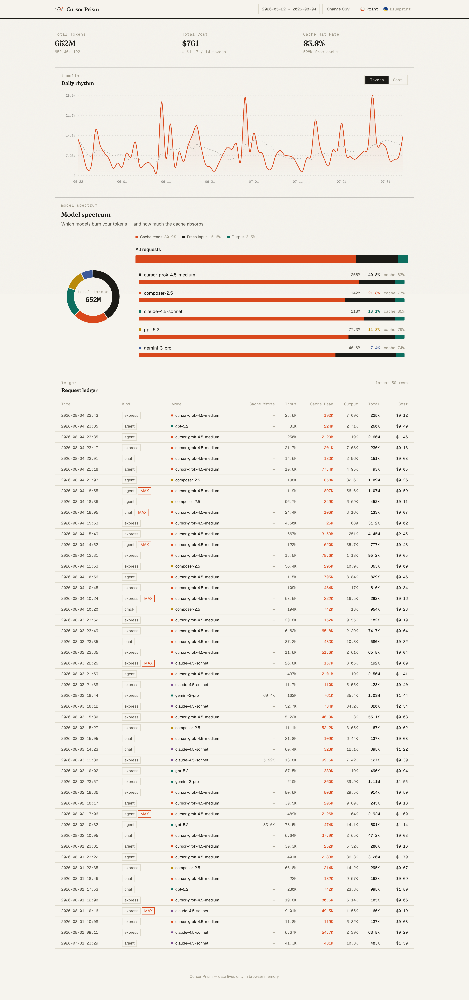
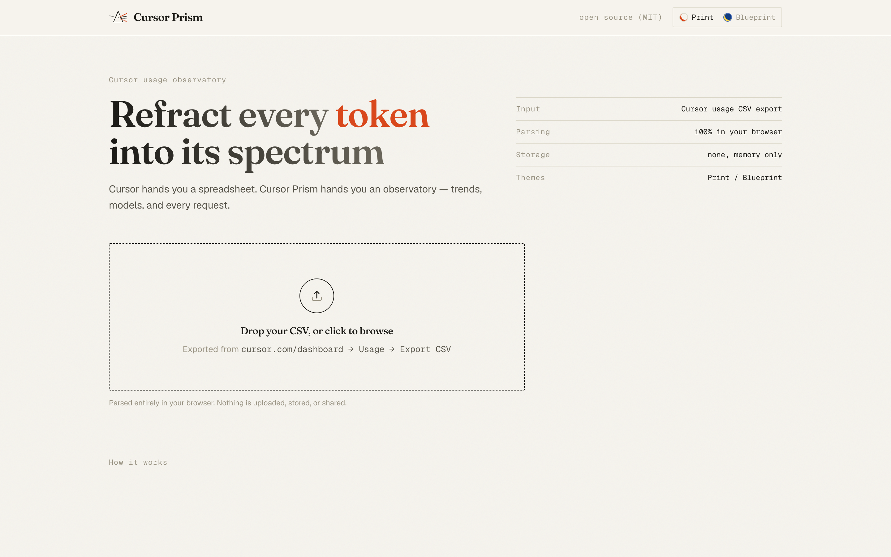
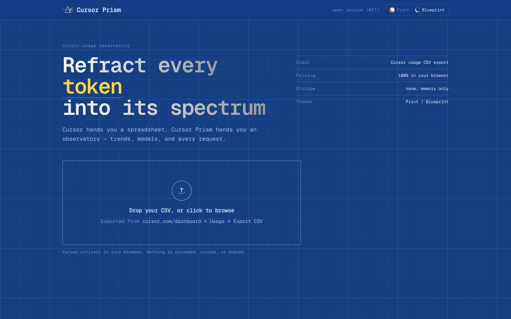

# Cursor Prism

> Refract every Cursor token into its spectrum.

The Cursor dashboard hands you a plain table. **Cursor Prism** turns your exported usage CSV into an observatory: trends, per-model share, cache economics — all hand-drawn, all in your browser.

**100% local parsing** — your CSV never leaves the browser (`FileReader`, in-memory only). Nothing is uploaded, tracked, persisted, or stored server-side. There is no server side.



## Two design languages

One semantic token system, two complete looks. Switch from the top bar — the change ripples out from your cursor with a circular View-Transition reveal, and your choice is remembered.

| Print | Blueprint |
| --- | --- |
| Editorial paper: Fraunces serif over Geist, ruled hairlines, vermilion accent, flat infographics | Technical drawing: Geist Mono, graph paper, construction dashes, one amber highlight |
|  |  |

## Two lenses

| Lens | What it shows |
| --- | --- |
| Trend Prism | Daily token & cost area charts with a 7-day moving-average reference |
| Model Spectrum | Per-model share donut fused with cache/fresh-input/output composition |

## Quick start

```bash
pnpm install
pnpm dev        # http://localhost:3000
```

Then:

1. **Export** — open [cursor.com/dashboard](https://cursor.com/dashboard) → Usage → **Export CSV**
2. **Drop** — drag the CSV onto the landing page (or click to browse)
3. **Explore** — two lenses on where your tokens actually go

## Tech stack

- [TanStack Start](https://tanstack.com/start) + React 19 + Vite
- Tailwind CSS v4
- **Zero chart libraries** — every visualization is hand-rolled SVG / Canvas (area chart, donut, stacked bars)
- Theme system: CSS variables + the View Transitions API, no runtime theme engine
- Cloudflare Workers ready (`wrangler.jsonc`)

## Project layout

```
src/
├── lib/                    # Pure data layer, UI-agnostic
│   ├── csv.ts              #   CSV parsing (quotes / escapes / BOM) and types
│   ├── analytics.ts        #   Aggregations: totals, trends, distribution
│   ├── theme.tsx           #   Theme tokens, provider, View-Transition switching
│   ├── colors.ts           #   Stable model → palette-slot mapping
│   ├── format.ts           #   Number / timestamp formatting
│   └── store.ts            #   Global in-memory store (no persistence)
├── components/
│   ├── charts/             # Hand-rolled visuals: TimelineChart / ModelSpectrum
│   ├── KpiRow.tsx          # KPI strip with rolling numbers
│   ├── TaglineReveal.tsx   # Word-by-word scroll reveal on the landing page
│   ├── NotFound.tsx        # Branded 404
│   ├── ThemeSwitcher.tsx   # Print / Blueprint swatches
│   ├── UploadZone.tsx      # Drag & drop upload
│   └── Logo.tsx            # currentColor-driven prism mark
└── routes/
    ├── index.tsx           # Landing: CSV upload
    └── dashboard.tsx       # The observatory
```

## Scripts

```bash
pnpm dev          # Dev server
pnpm build        # Production build
pnpm check        # Biome lint + format check
pnpm typecheck    # TypeScript type checking
pnpm screenshots  # Headless-Chrome smoke test + docs screenshots
pnpm deploy       # Build & deploy to Cloudflare Workers
```

## Privacy

Cursor Prism has no backend, no database, and no analytics. Your CSV lives only in browser memory — navigate away or close the tab and it's gone. The only thing ever persisted is your theme choice (`localStorage`), never your data. The source is right here; audit away.

## License

[MIT](LICENSE)
